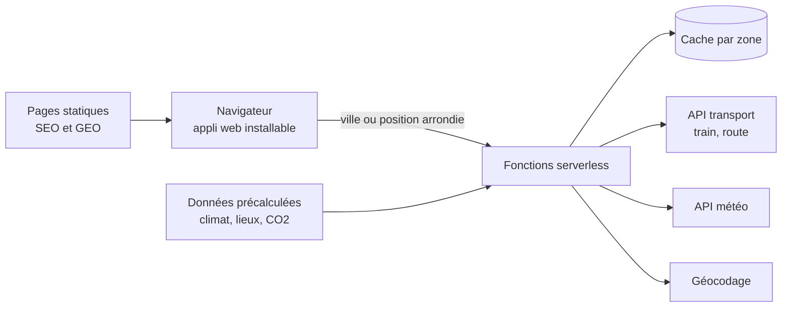

# Architecture de Beau Fixe, vue d'ensemble

Une vue d'ensemble des choix techniques, sans le code. Elle montre comment une application utile peut rester simple, sobre et respectueuse de la vie privée.

## Les choix

- Une appli web plutôt qu'une appli native. Une seule base, installable sur téléphone, sans passer par les magasins d'applications.
- Des fonctions serverless entre le navigateur et les API. Les clés restent côté serveur, jamais dans le navigateur ni dans le code versionné.
- Un cache par zone de départ. Deux personnes proches partagent le même calcul, ce qui respecte les quotas des API et accélère les réponses.
- Des données lourdes préparées à l'avance (climat, lieux, facteurs d'émission), par des scripts et des tâches planifiées, plutôt qu'à chaque requête.
- Des pages statiques générées pour chaque destination, lisibles sans JavaScript, pour les moteurs de recherche et les IA génératives.
- Aucune donnée personnelle nécessaire. Position arrondie dans le navigateur, réglages gardés dans le stockage local, mesure d'audience sans cookie.

## Le chemin suivi

1. Un serveur MCP en Python, utilisé directement dans Claude, pour valider l'idée avec trois outils : gares proches, destinations accessibles, météo du week-end.
2. Une appli web mobile sur le même socle de données, mise en ligne dès le deuxième jour.
3. Des incréments courts, chacun testé sur un aperçu avant la production.
